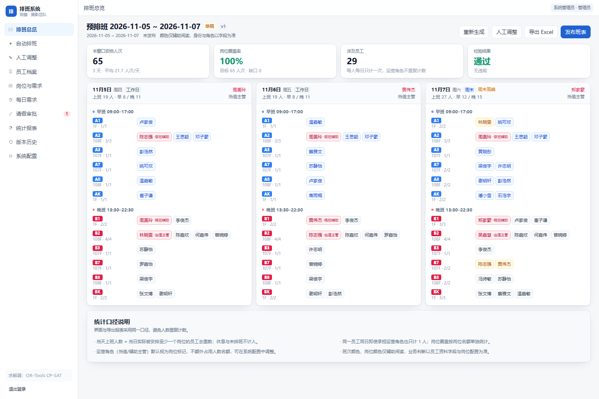
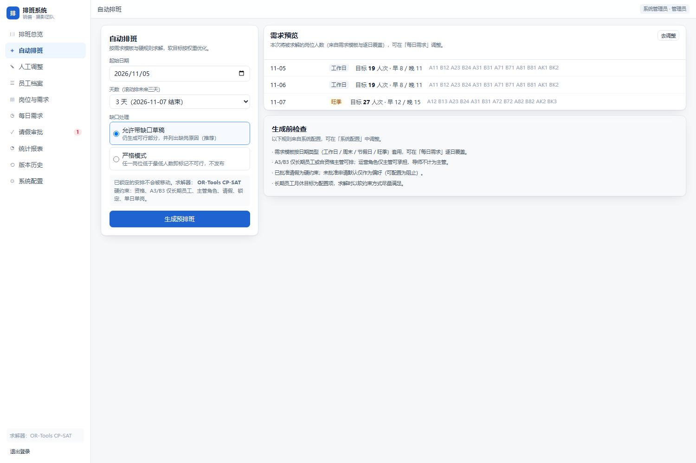
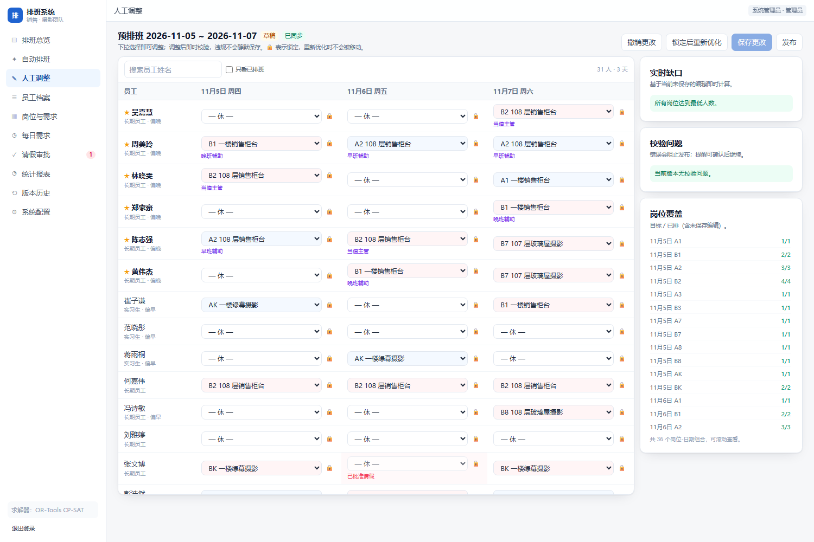
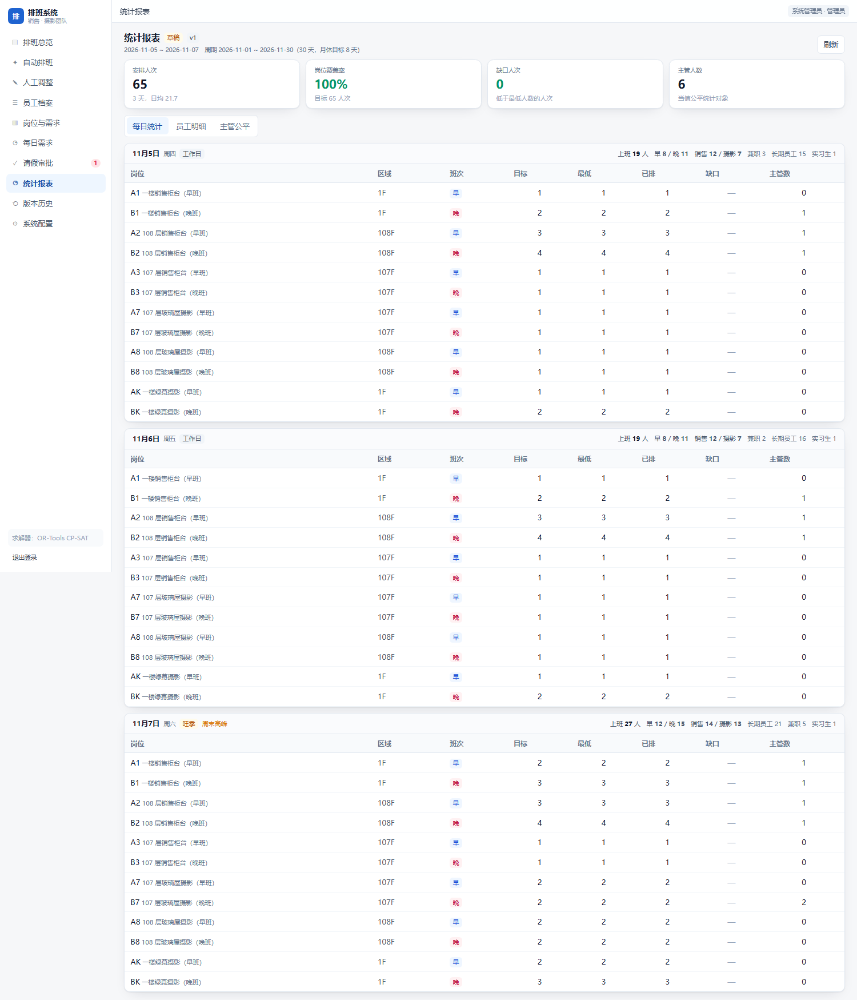
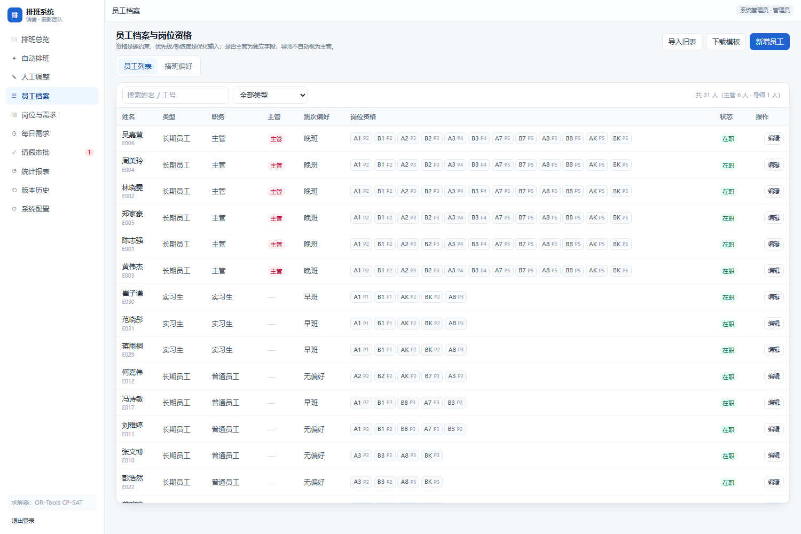
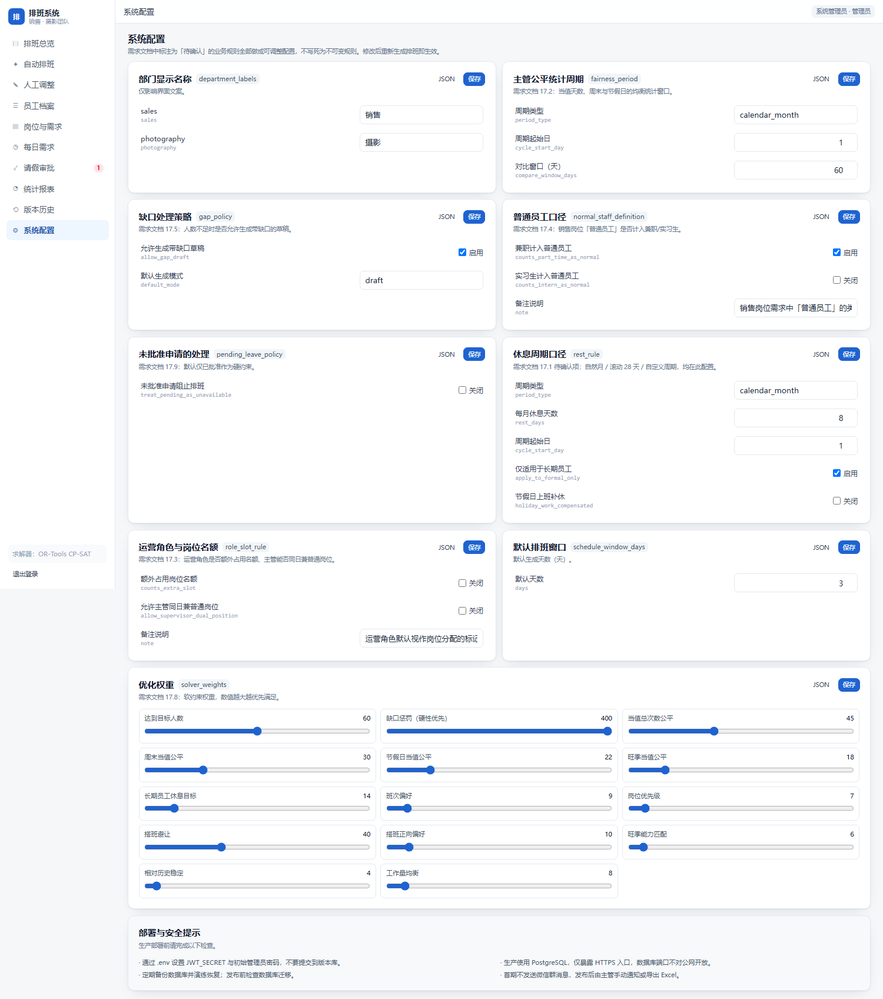

# 游乐园人员排班系统（销售与摄影团队）

按《排班自动化系统：需求与技术设计》实现的 MVP：**自动生成未来三天预排班 → 主管审核微调 → 发布不可变版本**，
覆盖岗位资格校验、岗位覆盖缺口诊断、主管当值公平、请假硬约束、Excel 导入导出与操作留痕。

- 后端：Python 3.13 + FastAPI + SQLAlchemy + **OR-Tools CP-SAT**
- 数据库：本地 SQLite（开箱即用）/ 生产 PostgreSQL 16（Alembic 迁移已就绪）
- 前端：Next.js 15 + TypeScript + Tailwind（静态导出，可由后端同端口托管）
- 部署：Docker Compose + Caddy（自动 HTTPS）

> 所有代码、数据、依赖均位于 `D:\workbuddy-projects\park-scheduling`，不占用 C 盘空间。

---

## 0. 线上环境（v1.1.0）

| 项 | 值 |
|---|---|
| 访问地址 | **https://canton.1gavin.online/** （Let's Encrypt 证书，HTTP 自动跳转 HTTPS） |
| 备用入口 | http://8.217.198.163/ （IP 直连，仅供运维排查） |
| 代码仓库 | https://github.com/undefinedx1n/canton |
| 管理员账号 | `admin`，初始密码见服务器 `/root/.scheduler-admin-pwd`（随机生成，登录后请到「系统配置 → 账号与安全」更换） |
| 部署架构 | 宿主机 nginx :80/:443 → `127.0.0.1:8000`（FastAPI + 静态前端）→ PostgreSQL 16 容器 |
| 证书续期 | `certbot-renew.timer` 每日检查，续期后自动 reload nginx |
| 部署记录 | [docs/RELEASE-v1.0.md](docs/RELEASE-v1.0.md) |
| 运维手册 | [docs/DEPLOY.md](docs/DEPLOY.md) |

上线后先在「员工档案」导入真实名单，核对「每日需求」，再执行自动排班。

---

## 1. 快速开始（Windows，本机已配置完成）

```bat
:: 首次安装（已执行过可跳过）
scripts\setup.bat

:: 单端口启动（推荐演示）：前端构建产物由后端托管
scripts\start.bat            → http://127.0.0.1:8000/login/

:: 开发模式（前端热更新）
scripts\start-dev.bat        → http://127.0.0.1:3000
```

演示账号：`admin / admin123456`（管理员）、`supervisor / supervisor123`（主管）。
接口文档：`http://127.0.0.1:8000/docs`。

> `start.bat` 会在**当前命令行窗口**前台运行服务，窗口关闭即停止（这是正常的，不是我这边进程退出）。
> 想开机常驻可用 `docker compose up -d`，或把该脚本加入「启动」目录 / 任务计划程序。

手工启动等价命令：

```bash
# 后端（在项目根目录 D:\workbuddy-projects\park-scheduling 下执行）
.venv\Scripts\python.exe -m uvicorn app.main:app --host 127.0.0.1 --port 8000 --app-dir backend

# 前端（开发热更新，另开一个窗口）
cd frontend && npm run dev

# 前端（构建，产出 frontend/out 后由后端同端口托管）
cd frontend && npm run build
```

---

## 2. 功能与需求对照

| 需求文档要点 | 实现位置 | 说明 |
|---|---|---|
| 岗位代码可配置（班次/部门/区域/资格/默认人数） | `positions` 表 + 「岗位与需求」页 | 不依赖 Excel 颜色，代码即数据 |
| 需求模板 + 逐日覆盖 + 目标/最低人数 | `demand_templates`、`daily_demands` | 支持工作日/周末/节假日/旺季四类模板 |
| 自动排班（硬约束+软约束） | `backend/app/services/solver.py` | CP-SAT，权重可配置，超时返回最佳可行解 |
| A3/B3 仅长期员工/主管 | 岗位 `allowed_employment_types` | 兼职/实习生即使勾选资格也不会被排入 |
| 运营角色只给主管（导师不算） | `employees.is_supervisor` 独立字段 | 陈嘉欣为导师，不满足主管资格 |
| 已批准请假为硬约束 | `availability_requests` | 未批准默认仅偏好，可配置为阻止 |
| 锁定后重新优化 | `POST /api/schedule/versions/{id}/reoptimize` | 锁定行不参与求解、不会被移动 |
| 缺口必须显式暴露 | `diagnostics.gaps` + 缺岗原因 | 不会用不合格人员伪造满足 |
| 人工调整即时校验 | `/edit` 页 + `validation.py` | 违规弹窗确认，发布时硬阻断 |
| 发布不可变版本 + 差异 + 留痕 | `schedule_versions`、`audit_logs` | 修改已发布版本自动派生新草稿 |
| 主管公平（总/周末/节假日/旺季） | `_add_fairness` + 统计报表 | 历史 + 本窗口联合计算、显示偏差 |
| 月休 8 天（周期口径可配） | `rest_rule` 配置 + 报表差额 | 支持自然月/滚动 28 天/自定义周期 |
| Excel 导入导出 | `routers/excel.py` | 导入先预览映射与校验，不覆盖生产数据 |
| 人数口径（每人每日计一次） | `services/stats.py` | 运营角色不重复计数，界面有口径说明 |

需求文档中标注「待确认」的 9 项业务规则全部落在「系统配置」中（`app_settings` 表），不做写死假设。

---

## 3. 目录结构

```
park-scheduling/
├── backend/
│   ├── app/
│   │   ├── main.py            # 应用入口（API + 静态站点托管）
│   │   ├── models.py          # 12 张业务表 + 账号/配置
│   │   ├── schemas.py         # 请求/响应模型
│   │   ├── security.py        # PBKDF2 密码 + JWT
│   │   ├── services/
│   │   │   ├── solver.py      # CP-SAT 求解器（含启发式回退）
│   │   │   ├── validation.py  # 排班校验（硬错误 / 提醒分级）
│   │   │   ├── stats.py       # 统计口径与公平分布
│   │   │   ├── config_service.py # 可配置业务规则
│   │   │   └── seed.py        # 31 人示例数据 + 历史排班
│   │   └── routers/           # auth/employees/positions/demands/
│   │                          # availability/scheduler/stats/settings/excel/audit
│   ├── alembic/               # 数据库迁移（初始版本已生成）
│   └── tests/                 # 93 项测试（硬规则/冲突/公平/接口/报表）
├── frontend/
│   ├── app/                   # 11 个页面（总览/生成/调整/员工/岗位/需求/审批/报表/版本/配置/登录）
│   ├── components/            # AppShell + UI 组件
│   └── lib/                   # API 客户端、类型、导出工具
├── scripts/                   # setup/start/init_demo/backup/restore/shots
├── deploy/Caddyfile           # HTTPS 反向代理
├── Dockerfile                 # 单镜像：前端构建 + 后端 API
├── docker-compose.yml         # db + api + caddy
└── data/schedule.db           # SQLite 数据（演示数据已初始化）
```

---

## 4. 排班求解模型

决策变量：员工 × 日期 × 岗位（仅对具备资格的组合作变量）。

**硬约束**
1. 每岗位人数 ≤ 名额；低于最低人数 → 缺口（`strict` 模式判不可行）。
2. 员工每日最多 1 个岗位。
3. 必须持有该岗位资格（`allowed=True`），且满足岗位允许的员工类型。
4. 运营角色（晚班当值 / 早班辅助 / 晚班辅助）只能由 `is_supervisor=True` 的员工承担，并与岗位绑定。
5. 已批准请假/不可用时间不可排。
6. 锁定安排固定，不可移动。

**软目标（权重可调）**：缺口惩罚 > 达到目标人数 > 当值/周末/节假日/旺季公平 > 休息目标 >
搭班避让 > 搭班偏好 > 班次偏好 > 岗位优先级 > 旺季能力匹配 > 工作量均衡。

结果页展示各目标加权值与缺口原因，不使用不可解释的文本生成代替约束求解。

---

## 5. 测试

```bash
cd backend && ../.venv/Scripts/python.exe -m pytest tests -q
# 92 passed, 1 xfailed in ~55s
```

| 文件 | 用例 | 覆盖内容 |
|---|---:|---|
| `test_solver.py` | 13 | 求解器核心回归（A3/B3、导师、角色绑定、请假、锁定、缺口） |
| `test_rules.py` | 17 | 硬规则逐条（资格、类型、角色、请假、名额、停用、每周上限） |
| `test_validation_rules.py` | 14 | 校验 14 个错误码与 error/warn 分级 |
| `test_conflict_cases.py` | 9 | 需求无法满足时的缺口诊断、不伪造满足、strict 模式 |
| `test_fairness_pairing.py` | 10 | 主管当值/周末/节假日公平、班次偏好、搭班三种作用范围 |
| `test_api_flow.py` | 18 | 生成→调整→锁定→重排→发布→修订→对比→导出→留痕 |
| `test_stats_reports.py` | 11 | 报表口径（去重计数、销售/摄影、休息、公平偏差） |

测试数据全部为 `seed.py` 生成的**虚构**员工，运行在 `pytest tmp_path` 的独立 SQLite 库中，
不读取 `data/schedule.db`、不使用生产凭证，可重复执行（窗口固定为工作日模板，随机种子固定）。

文档：
- `docs/TRACEABILITY.md` —— 需求 → 代码位置 → 测试用例的逐条追踪表
- `docs/ACCEPTANCE.md` —— 验收报告（通过/未覆盖项、缺陷修复、剩余风险、待业务决策事项）
- `docs/test-run.txt` —— 最近一次完整测试日志

---

## 6. 移动端适配

界面按「桌面优先、手机可读可操作」实现（需求文档 §14 末条）：

- 顶部导航在窄屏折叠为**覆盖式抽屉**（遮罩 + 点击自动收起），不再挤压正文；
- 多列表格统一横向滚动 + **首列冻结** + 边缘渐隐提示，避免被裁切后无法查看；
- 统计报表在手机上隐藏"区域/班次"冗余列，6 列一屏可读；
- 人工调整页日期列收窄并提供"左右滑动"提示，姓名列固定；
- 表单控件移动端最小高度 32px，按钮不换行。

自检脚本（需先启动服务）：

```bash
cd frontend
node ui-audit.mjs mobile     # 390×844，输出 docs/shots/m-*.png + 溢出报告
node ui-audit.mjs tablet     # 820×1180
node ui-audit.mjs desktop    # 1440×900
```

三档视口巡检结果：11 个页面文档级横向溢出均为 `0px`。

---

## 7. 数据与安全

- 密码使用 PBKDF2-SHA256（20 万次迭代）存储，登录签发 JWT；生产务必改 `JWT_SECRET` 与初始密码。
- 数据库不直接暴露公网；仅 443 入口，Caddy 自动签发证书。
- Excel 导入只新增不覆盖，全部写入 `audit_logs`。
- 备份/恢复脚本：`scripts/backup.sh`、`scripts/restore.sh`（详见 `docs/DEPLOY.md`）。

## 8. 重新初始化演示数据

```bash
.venv/Scripts/python.exe scripts/init_demo.py --force
# 31 名员工（6 主管 + 1 导师 + 16 长期 + 5 兼职 + 3 实习）、12 个岗位、4 套需求模板
# 过去 14 天已发布历史（用于公平/休息统计）+ 今天起 3 天草稿
```

> 演示数据用于验证流程，不代表真实员工资料；实际使用请在「员工档案」中导入真实名单（先预览再确认）。

---

## 9. 界面截图

完整截图见 `docs/shots/`（由无头 Chrome 实际登录后抓取，非设计稿）。

| 排班总览 | 自动排班 |
|---|---|
|  |  |

| 人工调整 | 统计报表 |
|---|---|
|  |  |

| 员工档案 | 系统配置 |
|---|---|
|  |  |
